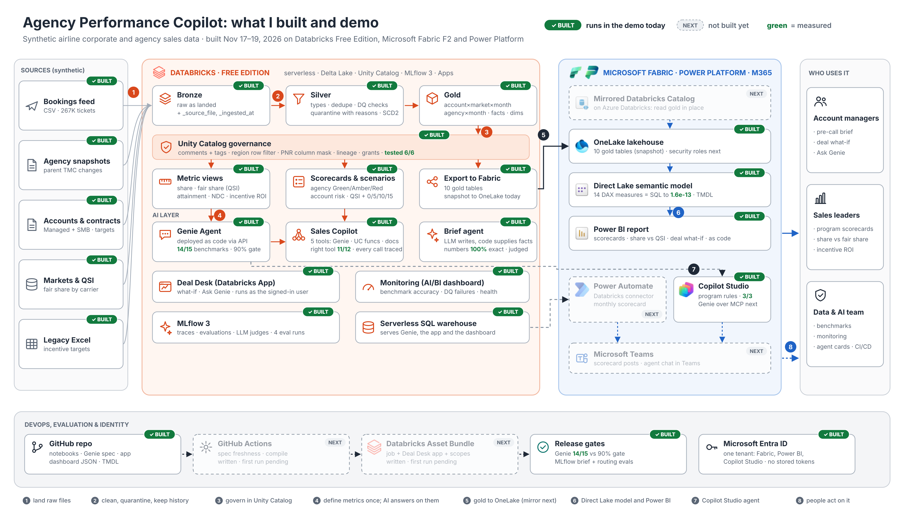
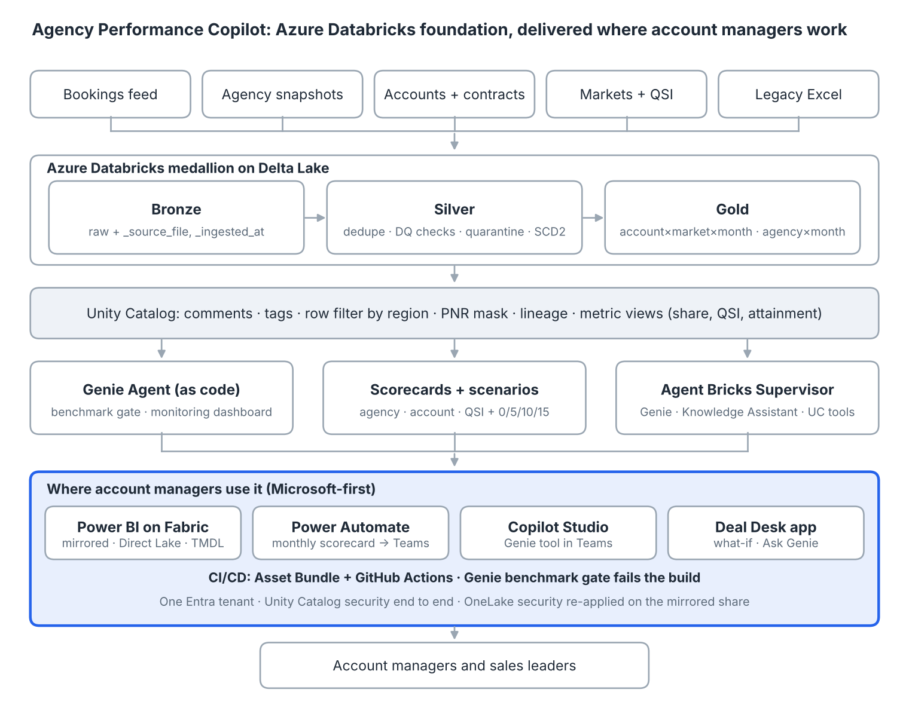

# Agency Performance Copilot

**Governed AI and analytics for airline corporate and agency sales. Built and running on Databricks (Unity Catalog, metric views, Genie, MLflow, Apps); plus a Microsoft slice (Fabric, Power BI, Copilot Studio) where account managers work, designed to move to Azure Databricks.**

**Status:** everything on Databricks runs today on Databricks Free Edition. The Fabric slice runs on a Fabric F2 capacity: OneLake lakehouse, a Direct Lake on OneLake semantic model built from code, DAX/SQL parity checked, TMDL exported, a Power BI report formatted as code, and a Copilot Studio agent (3/3 tests). Agent Bricks, Copilot Studio connected to Genie, and Power Automate are designed with setup steps written, not deployed. See [What runs today](#what-runs-today).

> All data in this project is synthetic and generated for demonstration. Company, agency and person names are invented. Competitor carriers are fictional (`XA`, `XB`). No American Airlines data is used.

## The problem

Corporate and agency sales teams cover more accounts than they have time for. Before a client call or a contract renewal, an account manager needs fast answers they can trust:

- Where are we below fair share for this account?
- Is the account on track for its contract target, and what target should we offer next?
- Which agencies are losing share, and is their incentive paying off?
- Are AAdvantage Business members actually getting credited?

Today those answers come from recurring manual reports and ad-hoc analyst requests.

## What this project does

```
Databricks (Free Edition today; Azure Databricks in production):
Raw files ─► Bronze ─► Silver ─► Gold ─► Governance ─► Metric views ─┬─► Genie Agent, deployed as code, 15-benchmark release gate
 CSV + Excel  audit    DQ+SCD2   grains   UC security   one definition ├─► Brief agent (LLM tool + MLflow evaluation)
                                                                      ├─► AI/BI dashboard: sales performance + AI and data quality
                                                                      ├─► Deal Desk app (what-if + Ask Genie, per-user security)
                                                                      ├─► Sales Copilot agent: routes to Genie, UC functions, program docs (notebook 13)
                                                                      └─► Fabric: OneLake lakehouse ─► Direct Lake model (DAX, parity-checked, TMDL) ─► Power BI
                                                                          designed: mirrored catalog (no copy) · Power Automate → Teams · Copilot Studio in Teams
CI/CD (written): Declarative Automation Bundle (Lakeflow job + app) · GitHub Actions · Genie gate fails the build
```

| Layer | What's built | Why it matters |
|---|---|---|
| **Bronze** | Raw CSVs and a legacy Excel workbook landed as-is, with `_source_file` and `_ingested_at` | Full audit trail back to the file |
| **Silver** | Typing, deduplication, data-quality checks, quarantine with reasons, reconciliation, SCD Type 2 agency history, Excel clean-up | Nothing is dropped silently; history survives agency re-parenting |
| **Gold** | Account × market × month, agency × month, AAdvantage Business compliance | One clear grain per table; weighted ratios only |
| **Scorecards and deals** | Quarterly agency scorecard (Green/Amber/Red), YTD account scorecard with risk status and talking points, contract scenarios at QSI + 0/5/10/15 | Replaces recurring manual reports; supports "modeling a good deal" |
| **Governance** | Business-language comments, tags, row filter by region, PNR column mask, lineage | Security in the data, inherited by every tool |
| **Semantic layer** | Unity Catalog metric views: passenger share, fair share (QSI), share gap, contract attainment, NDC share, incentive ROI | Each metric defined once; Genie, Power BI and the app agree |
| **Genie Agent** | Curated instructions, SQL expressions, example queries, entity matching, 15 core benchmarks + 10 advanced-SQL benchmarks | Plain-English answers for account managers, accuracy measured |
| **Genie as code + release gate** | Agent spec built from the guide, deployed with the Genie Management API; benchmarks run through the Conversation API, results logged, run fails below 90% | A Genie change is a reviewed pull request that can't make accuracy worse quietly |
| **Monitoring** | AI/BI dashboard created by API: accuracy per run, latest failures, data-quality failures, scorecard health | One place to answer "can we trust it?" |
| **Sales Copilot agent** | Tool-calling agent (notebook 13) that routes each question to the Genie Agent, governed UC functions (account snapshot, contract what-if, agency status) or program documents; MLflow tracing; routing accuracy measured on 12 questions. Same supervisor pattern as an Agent Bricks Supervisor Agent, built in code so it runs on Free Edition | One assistant for account managers, with every number coming from a governed tool |
| **Brief agent** | Tool-calling LLM drafts pre-call briefs from governed facts; MLflow 3 tracing and evaluation | Numbers checked by code, tone and grounding by LLM judges |
| **Microsoft layer** | **Built as code:** gold tables in a OneLake lakehouse, a Direct Lake semantic model generated with semantic-link-labs, the metric views re-implemented in DAX with a parity check against SQL, TMDL export, a Power BI report formatted as code, a Copilot Studio agent on the program documents. **Designed:** mirrored Unity Catalog (no copy), OneLake security by region, Power Automate to Teams, Copilot Studio calling Genie in Teams | Meets account managers in Power BI and Teams, with the same numbers as Genie |
| **Deal Desk app** | Databricks App: contract what-if and Ask Genie; runs as the signed-in user so the row filter applies; per-user caching | The deal-modeling step of the corporate contract lifecycle |
| **CI/CD** (written, not yet run against a workspace) | Declarative Automation Bundle, formerly Databricks Asset Bundle (Lakeflow job + app), GitHub Actions: spec freshness, compile, deploy, Genie gate | One-command deploy; quality gates on every change |



*As built: green ✓ BUILT tags mark what runs today (26 parts); faded, dashed boxes are next.*



*Target architecture on Azure. What runs today is listed below.*

## What runs today

| Piece | Status |
|---|---|
| Notebooks 01–10, Deal Desk app | Built and run on Databricks Free Edition |
| Notebook 11 (documents, UC functions, routing set), 13 (Sales Copilot agent) | Built and run on Free Edition; routing 11/12 (92%) |
| Notebook 14 (Lakeflow job created from code) | Built for Free Edition; first run pending |
| Copilot Studio Program Rules Assistant (`microsoft/COPILOT_STUDIO_STEPS.md`) | **Built and tested** in a Developer environment billed pay-as-you-go to Azure: grounded only on the 4 program documents (web search and other tools removed). 3/3 test questions pass, including the guardrail (asked for Zhang PLC's attainment, it gives no number and points to Deal Desk / Genie). About 3–16 Copilot credits per answer ($0.01 each; the first answer in a chat costs the most) |
| Fabric lakehouse + Direct Lake model (`fabric/01_load_gold_to_lakehouse.ipynb`) | Built and run on a Fabric F2 capacity (Azure): 10 tables in OneLake, Direct Lake on OneLake model with 14 DAX measures, DAX = SQL parity PASS (largest difference 1.6e-13), 12 TMDL files |
| Agent Bricks Supervisor and Knowledge Assistant | Designed; needs Azure Databricks Premium |
| Notebook 12 (`fabric_share` for a mirrored catalog), Copilot Studio connected to Genie, Power Automate | Designed; needs Azure Databricks and Power Platform |
| Bundle deploy and GitHub Actions | Written; not yet run against a workspace |

## Results

| Measure | Value |
|---|---|
| Bookings processed | ~267,000 |
| Rows quarantined, with reasons | ~2,390 (duplicates, missing account IDs, unknown agencies, non-positive fares) |
| SMB bookings missing the AAdvantage Business ID | ~9% flagged |
| Agencies with SCD2 history | 8 |
| Agency scorecard (latest quarter) | 104 Green · 28 Amber · 68 Red |
| Managed accounts at risk (attainment < 90%) | 69 of 200 |
| Brief agent (20 accounts, `databricks-gpt-oss-120b`) | Key numbers exact **100%** · no invented numbers **95%** · word limit, actionable, tone **100%** (run 4) |
| Genie benchmark accuracy | **9/15 first run → 14/15 after root-cause fixes** (gate 90%); advanced SQL tier 5/10, tracked, not gating |

See [`docs/EVAL_REPORT.md`](docs/EVAL_REPORT.md) for the iteration log.

## Key design decisions

1. **Quarantine, don't drop.** Every failed row is kept with a reason, and counts reconcile exactly: bronze = silver + quarantine.
2. **SCD Type 2 for agencies.** Historical share stays with the parent company the agency had at the time.
3. **Weighted ratios only.** Share is `SUM(aa_pax) / SUM(total_pax)`, never an average of percentages.
4. **Low-QSI exclusion.** Markets where fair share is under 5% are excluded from "QSI + X" contract targets.
5. **Security at the data layer.** Row filters and masks live in Unity Catalog, so Genie, Power BI, the flow, the agent and the app can only see what their identity is allowed to see.
6. **The LLM never does arithmetic.** The brief agent receives pre-computed, formatted facts from a tool, and a code-based scorer checks that every number in the brief matches.
7. **Benchmarks as a release gate.** Any change to tables, instructions or expressions re-runs all 15 core benchmarks; an advanced tier (window functions, gaps and islands, anti-joins, pivots) is tracked separately. See `docs/ADVANCED_SQL.md`.
8. **Microsoft-first delivery.** Databricks is the governed foundation; account managers use the results where they already work.

## How to run it

1. **Databricks Free Edition** runs notebooks 01–11 and 13 and the app. For the full Azure build (Agent Bricks, mirrored catalog, Copilot Studio), follow [`AZURE_BUILD_GUIDE.md`](AZURE_BUILD_GUIDE.md).
2. **Workspace → Create → Git folder** with this repo's URL, then run notebooks 01 → 10 in order, or deploy everything with `databricks bundle deploy --var warehouse_id=<id>` and `databricks bundle run copilot_pipeline`.
3. Learn the Genie Agent by building it by hand with [`genie/GENIE_AGENT_SETUP.md`](genie/GENIE_AGENT_SETUP.md); notebook 09 deploys the same agent as code.
4. Fabric and Power BI: [`microsoft/FABRIC_POWERBI_STEPS.md`](microsoft/FABRIC_POWERBI_STEPS.md). The rest of the Microsoft layer: [`microsoft/MICROSOFT_LAYER_GUIDE.md`](microsoft/MICROSOFT_LAYER_GUIDE.md).
5. Deploy the app with [`app/APP_SETUP.md`](app/APP_SETUP.md).

Full walkthrough: [`AZURE_BUILD_GUIDE.md`](AZURE_BUILD_GUIDE.md). Public demo (no sign-in, snapshot data): [`public_demo/`](public_demo/).

## Repository

```
notebooks/
  01_generate_synthetic_data.py   synthetic sources + planted defects + messy Excel
  02_bronze_ingest.py             raw landing with lineage columns
  03_silver_quality.py            DQ checks, quarantine, DQ log, Excel clean-up, SCD2
  04_gold_model.py                business tables at clear grains
  05_governance.py                comments, tags, row filter, column mask
  06_metric_views.py              certified metrics with MEASURE()
  07_scorecards_and_deals.py      agency + account scorecards, contract scenarios
  08_brief_agent_mlflow.py        LLM brief agent, MLflow tracing + evaluation
  09_genie_agent_as_code.py       deploy Genie via API, run benchmarks, release gate
  10_monitoring_dashboard.py      AI/BI dashboard via API (sales + monitoring pages)
  11_agent_bricks_prep.py         program docs, UC functions, routing eval for the Sales Copilot agent
  12_fabric_share.py              schema Fabric mirrors (no row filters) + OneLake parity check
  13_sales_copilot_agent.py       tool-calling Sales Copilot agent + routing evaluation
  14_lakeflow_job_as_code.py      creates and runs the whole pipeline as a Lakeflow job (SDK)
AZURE_BUILD_GUIDE.md              the full build on Azure Databricks + Fabric + Power Platform
genie/GENIE_AGENT_SETUP.md        agent configuration + 15 core and 10 advanced benchmarks (source of truth)
genie/build_agent_spec.py         builds agent_spec.json (serialized_space) from the guide
dashboards/monitoring.lvdash.json dashboard definition
data/gold/*.parquet               gold tables exported for Fabric
fabric/                           OneLake load + Direct Lake model as code + DAX/SQL parity + TMDL export
microsoft/FABRIC_POWERBI_STEPS.md Fabric trial, lakehouse, report pages, fallback
microsoft/COPILOT_STUDIO_STEPS.md Program Rules Assistant grounded on docs/program_docs/
microsoft/powerbi/measures.dax    Direct Lake measures
databricks.yml                    Declarative Automation Bundle (formerly Asset Bundle): Lakeflow job + Deal Desk app
.github/workflows/ci.yml          CI/CD
microsoft/MICROSOFT_LAYER_GUIDE.md Power BI (DAX, what-if, TMDL), Power Automate, Copilot Studio, Fabric
app/                              Deal Desk: Databricks App (Streamlit)
docs/AGENT_CARD.md                purpose, data, limits, evaluation, owner (Genie + brief agent)
docs/METRIC_DICTIONARY.md         every certified metric, defined once
docs/EVAL_REPORT.md               benchmark results and iteration log
docs/ADVANCED_SQL.md              advanced SQL patterns: pipeline and Genie advanced tier
docs/BUSINESS_CASE.md             time-saved estimate with stated assumptions
docs/ENABLEMENT_PLAN.md           pilot, adoption, success measures, feedback loop
```

## What's next

| Next | Purpose |
|---|---|
| Automated OneLake security parity test | Compare per-region row counts between Unity Catalog and OneLake on every deploy |
| Brief evaluation in CI | Add the MLflow evaluation of notebook 08 to the gate, next to the Genie benchmarks |
| Usage and cost monitoring | Genie and app usage from system tables on the monitoring dashboard |
